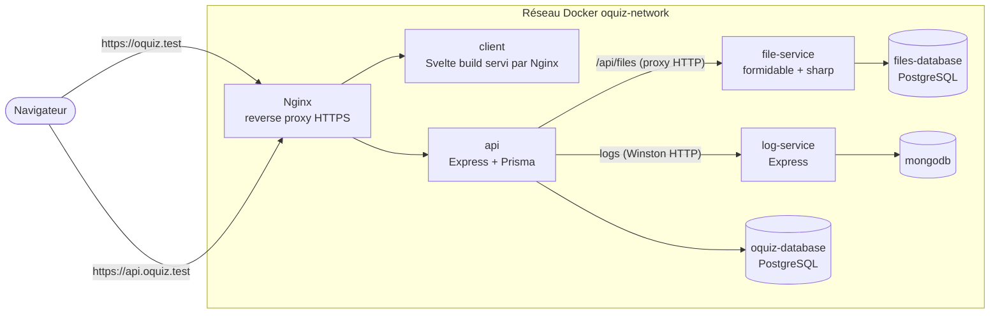

# O'Quiz

Plateforme de quiz en **architecture microservices entièrement dockerisée** :
une API REST (Express 5 + TypeScript + Prisma + PostgreSQL), un client
Svelte 5, un service d'upload d'images, un service de logs (MongoDB), le tout
derrière un reverse proxy Nginx en HTTPS.

> Le sujet, les cours et les supports pédagogiques du projet (fournis par
> O'Clock) ne sont pas republiés dans ce dépôt.

## Sommaire

- [O'Quiz](#oquiz)
  - [Sommaire](#sommaire)
  - [Fonctionnalités](#fonctionnalités)
  - [Architecture](#architecture)
  - [Stack technique](#stack-technique)
  - [Installation (Docker)](#installation-docker)
    - [Prérequis](#prérequis)
    - [1. Variables d'environnement](#1-variables-denvironnement)
    - [2. Certificats HTTPS locaux](#2-certificats-https-locaux)
    - [3. Construire et démarrer](#3-construire-et-démarrer)
  - [Développement sans Docker](#développement-sans-docker)
  - [Comptes de démonstration](#comptes-de-démonstration)
  - [Variables d'environnement](#variables-denvironnement)
  - [Structure du projet](#structure-du-projet)
  - [Authentification et rôles](#authentification-et-rôles)
  - [Endpoints principaux](#endpoints-principaux)
  - [Tests et intégration continue](#tests-et-intégration-continue)
  - [Limites connues](#limites-connues)

## Fonctionnalités

- **Authentification** : inscription, connexion, déconnexion, rafraîchissement
  de session — access token JWT + refresh token stockés en cookies `HttpOnly`,
  mots de passe hachés avec Argon2
- **Autorisation par rôles (RBAC)** : `member`, `author`, `admin`, vérifiés
  par un middleware `checkRoles`
- **Niveaux et tags** : CRUD complet, réservé aux auteurs/administrateurs en
  écriture
- **Upload d'images** : un microservice dédié reçoit les fichiers
  (`multipart/form-data`, formidable) et stocke leurs métadonnées dans sa
  propre base PostgreSQL ; à la récupération, l'image peut être redimensionnée
  et recompressée à la volée avec sharp (`?resize=300x200&quality=80`)
- **Logs centralisés** : chaque requête est tracée (Winston) et envoyée à un
  microservice de logs qui les persiste dans MongoDB
- **Validation des entrées** avec Zod, protection XSS (`express-xss-sanitizer`),
  en-têtes de sécurité (`helmet`), CORS restreint
- **Gestion d'erreur centralisée** : codes HTTP cohérents, aucune stack trace
  renvoyée au client en production
- **Documentation OpenAPI** (Swagger UI) servie par l'API

## Architecture

Chaque brique tourne dans son propre conteneur, sur un réseau Docker commun.
Seul le reverse proxy est exposé (port 443) — plus Adminer et Mongo Express,
outils d'administration accessibles depuis la machine hôte uniquement.



Côté images Docker :

- **client** : build **multi-stage** — étape 1 `node:22-alpine` compile
  l'application Vite, étape 2 `nginx:alpine` ne sert que le dossier `dist`
- **api** : build **multi-stage** — étape 1 installe, génère le client Prisma
  et compile le TypeScript, étape 2 ne garde que le JS compilé, les migrations
  et les dépendances. Au démarrage : migrations, échantillonnage, serveur
- **file-service** : applique ses migrations Prisma au démarrage, une fois sa
  base déclarée saine (`healthcheck` + `depends_on: service_healthy`)
- **proxy** : `nginx:alpine` configuré au démarrage par `envsubst` à partir
  d'un modèle (`proxy-service/nginx.template.conf`), noms de domaine injectés
  par variables d'environnement
- Données persistées dans des **volumes** (bases PostgreSQL, MongoDB) et un
  montage de dossier pour les fichiers uploadés

## Stack technique

- **Runtime** : Node.js 22, Express 5, TypeScript (`tsx` en dev, `tsc` en build)
- **Base de données** : PostgreSQL 17 via Prisma 7 (adaptateur `pg`) ; MongoDB 8
  pour les logs
- **Sécurité** : JWT, Argon2, Zod, helmet, CORS, cookies `HttpOnly`
- **Frontend** : Svelte 5 + Vite
- **Infra** : Docker, Docker Compose, Nginx (reverse proxy + TLS)
- **Qualité** : `node:test` (tests unitaires et d'intégration), ESLint,
  GitHub Actions

## Installation (Docker)

### Prérequis

- Docker + Docker Compose
- [mkcert](https://github.com/FiloSottile/mkcert) pour générer un certificat
  HTTPS reconnu par le navigateur en local

```bash
git clone https://github.com/IzzuTahutiz/oquiz.git
cd oquiz/src
```

### 1. Variables d'environnement

```bash
cp .env.docker.example .env.docker
```

Remplace au minimum `JWT_SECRET` par une longue chaîne aléatoire (et, hors
démo locale, les mots de passe des bases). Le fichier `.env.docker` n'est
jamais versionné.

### 2. Certificats HTTPS locaux

```bash
mkcert -install
mkdir -p proxy-service/certs
mkcert -cert-file proxy-service/certs/local.pem \
       -key-file proxy-service/certs/local-key.pem \
       oquiz.test api.oquiz.test
```

Le dossier `certs/` est ignoré par Git.

### 3. Construire et démarrer

Le script `deploy.sh` regroupe les commandes Docker Compose :

```bash
./deploy.sh build   # construit les images
./deploy.sh start   # ajoute oquiz.test et api.oquiz.test à /etc/hosts (sudo) puis démarre
./deploy.sh stop    # arrête et supprime les conteneurs (les volumes sont conservés)
```

Équivalent sans le script (ajouter soi-même
`127.0.0.1 oquiz.test api.oquiz.test` à `/etc/hosts`) :

```bash
docker compose -p oquiz --env-file .env.docker up -d --build
```

| Service | URL |
| --- | --- |
| Client | <https://oquiz.test> |
| API | <https://api.oquiz.test/api> |
| Documentation Swagger | <https://api.oquiz.test/api/api-docs> |
| Adminer (PostgreSQL) | <http://localhost:8880> |
| Mongo Express (logs) | <http://localhost:8881> |

## Développement sans Docker

Chaque service se lance aussi seul en mode `--watch` (il faut alors une base
PostgreSQL accessible, par exemple via `docker run postgres:17`) :

```bash
cd src/api
npm install
cp .env.example .env        # adapter DATABASE_URL et JWT_SECRET
npm run db:generate
npm run db:reset            # migrations + jeu de données de démo
npm run dev                 # http://localhost:3000

cd ../client
npm install
cp .env.example .env
npm run dev                 # http://localhost:5173
```

`file-service` et `log-service` suivent le même principe (`npm run dev`,
`.env.example` fourni dans chaque dossier).

## Comptes de démonstration

Créés au démarrage par l'échantillonnage (`src/api/src/models/seeding.ts`),
mot de passe `Password!1234` pour les trois :

| Email | Rôle |
| --- | --- |
| `alice@oquiz.test` | admin |
| `bob@oquiz.test` | author |
| `charly@oquiz.test` | member |

## Variables d'environnement

Fichier `src/.env.docker` (lu par Docker Compose) :

| Variable | Description |
| --- | --- |
| `POSTGRES_OQUIZ_*`, `OQUIZ_DATABASE_URL` | Base principale de l'API |
| `POSTGRES_FILES_*`, `FILES_DATABASE_URL` | Base des métadonnées de fichiers |
| `JWT_SECRET` | Clé de signature des tokens |
| `NODE_ENV` | `production` masque les stack traces dans les réponses |
| `ALLOWED_ORIGINS` | Origine(s) autorisée(s) par CORS |
| `VITE_API_BASE_URL` | URL de l'API injectée dans le build du client |
| `CLIENT_SERVER_NAME`, `API_SERVER_NAME` | Noms de domaine servis par Nginx |
| `ADMINER_LOCAL_PORT`, `MONGO_EXPRESS_PORT` | Ports des outils d'administration |

Chaque service a aussi son `.env.example` pour le lancement hors Docker.

## Structure du projet

```text
src/
├── docker-compose.yml      # Orchestration de tous les conteneurs
├── deploy.sh               # build / start / stop
├── .env.docker.example
├── api/                    # API REST principale
│   ├── Dockerfile          # multi-stage
│   ├── prisma/             # schéma + migrations
│   ├── src/
│   │   ├── routers/        # endpoints (+ annotations Swagger)
│   │   ├── controllers/    # orchestration requête/réponse (+ tests *.spec.test.ts)
│   │   ├── middlewares/    # auth/rôles, logs, 404, gestion d'erreur
│   │   ├── lib/            # erreurs HTTP, tokens, validateurs Zod, logger
│   │   └── models/         # client Prisma, échantillonnage
│   └── test/               # mise en place des tests d'intégration
├── client/                 # Svelte 5 + Vite, Dockerfile multi-stage → Nginx
├── file-service/           # microservice d'upload (formidable, sharp, Prisma)
├── log-service/            # microservice de logs (MongoDB)
├── proxy-service/          # modèle de config Nginx + entrypoint envsubst
└── tests/                  # scénarios .http (REST Client)
```

## Authentification et rôles

À la connexion, l'API dépose un access token (courte durée) et un refresh
token en cookies `HttpOnly` : ils ne sont pas lisibles en JavaScript côté
navigateur. `POST /api/auth/refresh` renouvelle l'access token, `POST
/api/auth/logout` révoque le refresh token.

| Rôle | Droits |
| --- | --- |
| `member` | lecture des niveaux et tags |
| `author` | + création/modification/suppression des niveaux et tags |
| `admin` | + liste des utilisateurs |

## Endpoints principaux

Tous préfixés par `/api`. Documentation complète : Swagger UI (`/api/api-docs`).

| Méthode | Route | Description | Accès |
| --- | --- | --- | --- |
| POST | `/auth/register` | Créer un compte | Public |
| POST | `/auth/login` | Se connecter | Public |
| POST | `/auth/refresh` | Renouveler l'access token | Public (cookie) |
| POST | `/auth/logout` | Se déconnecter | Authentifié |
| GET | `/auth/me` | Compte connecté | Authentifié |
| GET | `/users` | Liste des utilisateurs | admin |
| GET | `/levels`, `/levels/:id` | Niveaux | member+ |
| POST, PATCH, DELETE | `/levels`, `/levels/:id` | Gérer les niveaux | author, admin |
| GET | `/tags`, `/tags/:id` | Tags | member+ |
| POST, PATCH, DELETE | `/tags`, `/tags/:id` | Gérer les tags | author, admin |
| POST | `/files` | Uploader une image (champ `image`) | voir limites |
| GET | `/files/:id` | Récupérer une image (`?resize=LxH`, `?quality=1-100`) | Public |

## Tests et intégration continue

```bash
cd src/api
npm test          # tests unitaires puis tests d'intégration
```

Les tests d'intégration (`node:test`) démarrent eux-mêmes un conteneur
PostgreSQL jetable, appliquent les migrations, lancent un serveur Express de
test et vident les tables entre chaque test — Docker doit donc être démarré.

Le workflow GitHub Actions `.github/workflows/api-ci.yml` exécute la même
suite à chaque push et pull request sur `master`.

Des scénarios manuels sont fournis dans `src/tests/*.http` (extension
REST Client de VS Code).

## Limites connues

- **Upload non protégé** : `POST /api/files` n'exige pas encore
  d'authentification (le contrôle de rôle est préparé mais commenté dans
  `src/api/src/routers/files.router.ts`)
- Le client Svelte est encore minimal (authentification et affichage de
  données) : l'interface de création/passage de quiz reste à construire
- Déploiement prévu pour un usage local (`*.test` + certificats mkcert) ;
  une mise en ligne nécessiterait de vrais noms de domaine et certificats
  (Let's Encrypt)

---

Projet réalisé par Dimitry Dereppe, dans le cadre de la formation CDA — O'Clock.

[github.com/IzzuTahutiz](https://github.com/IzzuTahutiz)
